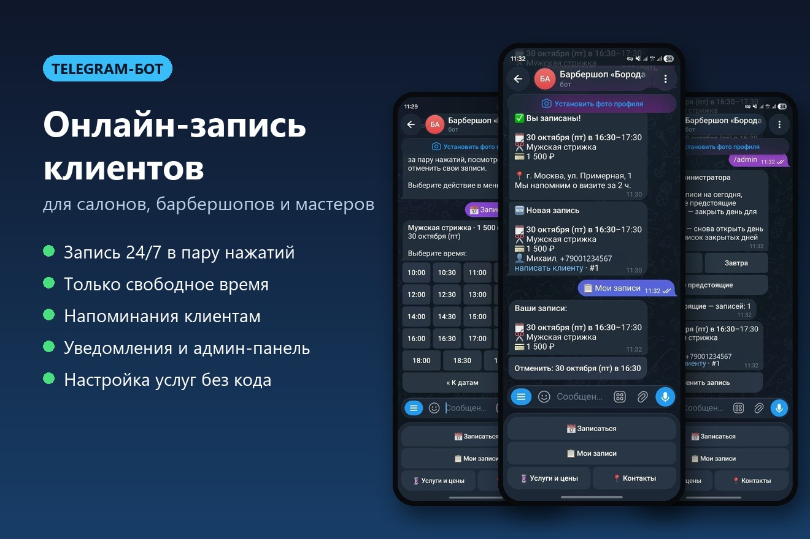
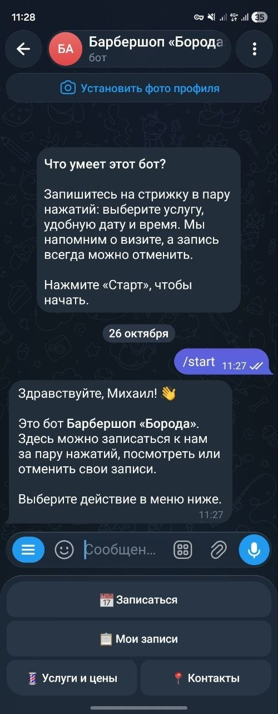
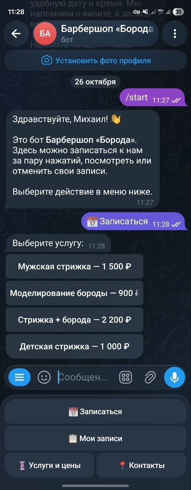
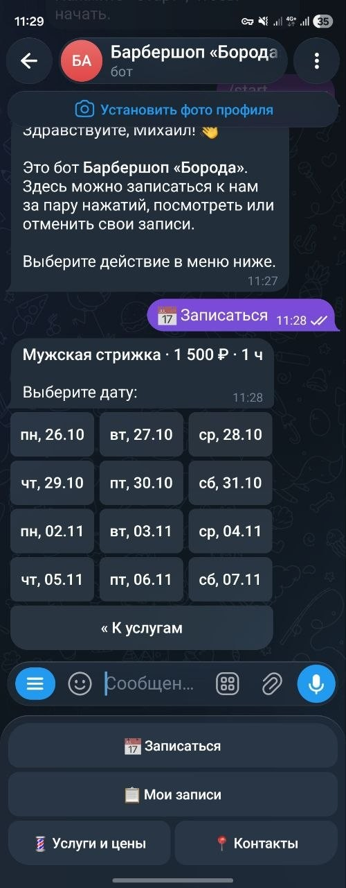
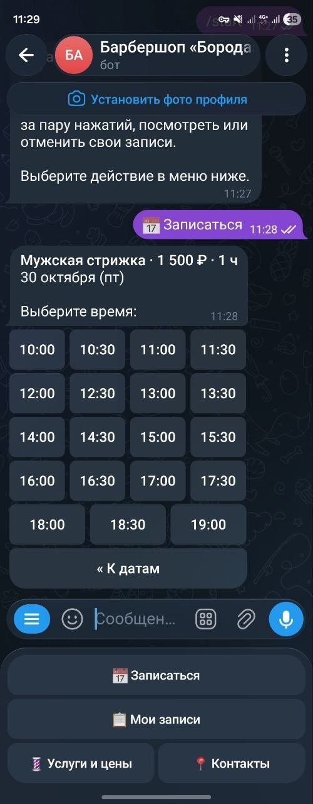
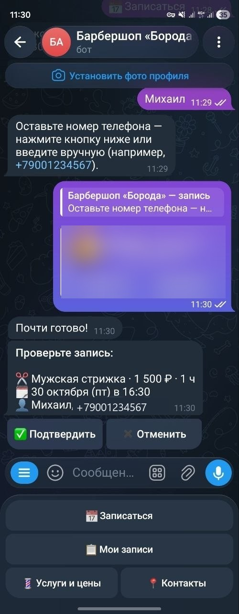
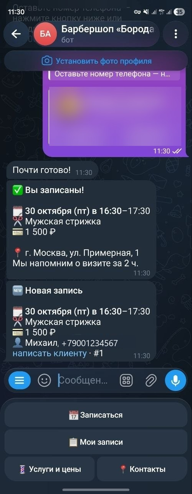
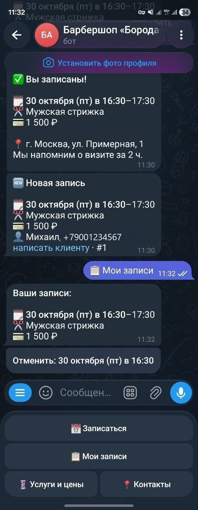
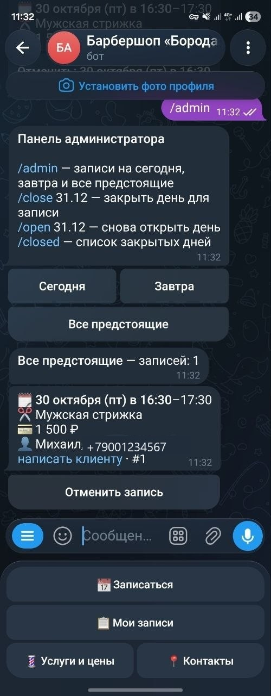
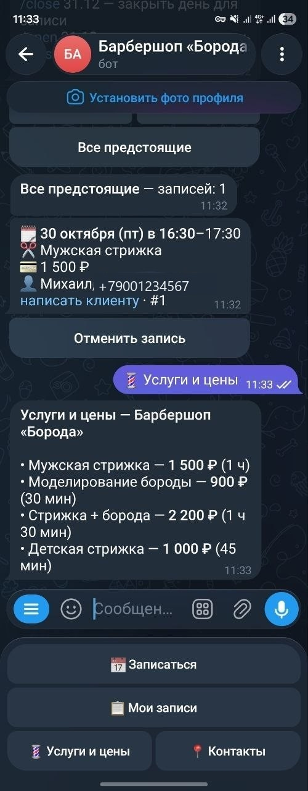

# Telegram-бот для онлайн-записи клиентов

[](https://github.com/lihor0/booking-bot/actions/workflows/tests.yml)

Бот для салонов, барбершопов, мастеров маникюра, массажистов, репетиторов — любого бизнеса, работающего по записи.
Клиент записывается за 30 секунд прямо в Telegram, администратор сразу получает уведомление.

**Стек:** Python 3.11+, aiogram 3, SQLite (aiosqlite), pytest



## Как это выглядит

| Старт | Выбор услуги | Выбор даты |
|:-:|:-:|:-:|
|  |  |  |
| **Свободное время** | **Подтверждение** | **Готово + уведомление админу** |
|  |  |  |
| **Мои записи** | **Админ-панель** | **Прайс-лист** |
|  |  |  |

## Возможности

**Для клиента**
- 📅 Запись в несколько нажатий: услуга → дата → время → имя → телефон
- Показываются только реально свободные даты и время с учётом длительности услуги
- 📱 Телефон одной кнопкой «Отправить мой номер»; при повторной записи бот помнит имя и телефон
- 📋 Просмотр и отмена своих записей
- ⏰ Автоматическое напоминание перед визитом
- 💈 Прайс-лист и контакты

**Для администратора**
- 🔔 Мгновенные уведомления о новых записях и отменах
- `/admin` — записи на сегодня, завтра и все предстоящие, отмена с уведомлением клиента
- `/close 31.12`, `/open 31.12` — закрыть/открыть день (праздник, отпуск)
- Несколько администраторов

**Надёжность**
- Защита от двойной записи: два клиента не смогут занять одно время, даже нажав одновременно
- Устаревшие кнопки (время заняли, пока клиент думал) обрабатываются корректно
- Бот не падает, если клиент его заблокировал
- 20 автотестов, включая сквозной сценарий записи через эмуляцию Telegram API

## Настройка без программирования

Всё настраивается в двух файлах:

- **`.env`** — токен, ID администраторов, название, адрес, рабочие часы и дни, шаг сетки, за сколько напоминать
- **`services.json`** — список услуг с ценой и длительностью:

```json
{"id": "haircut", "name": "Мужская стрижка", "price": 1500, "duration": 60}
```

## Запуск

1. Создайте бота у [@BotFather](https://t.me/BotFather) и получите токен
2. Узнайте свой Telegram ID у [@userinfobot](https://t.me/userinfobot)
3. Установите и запустите:

```bash
python -m venv .venv
# Windows: .venv\Scripts\activate    Linux/macOS: source .venv/bin/activate
pip install -r requirements.txt
cp .env.example .env    # заполните BOT_TOKEN и ADMIN_IDS
python -m bot
```

### Docker

```bash
docker build -t booking-bot .
docker run -d --restart unless-stopped --env-file .env -v $(pwd)/data:/app/data -e DB_PATH=data/bookings.db booking-bot
```

## Тесты

```bash
pip install -r requirements-dev.txt
pytest
```

## Структура

```
bot/
├── __main__.py      # точка входа
├── config.py        # загрузка настроек из .env и services.json
├── db.py            # работа с SQLite
├── slots.py         # расчёт свободного времени (чистые функции)
├── keyboards.py     # клавиатуры и callback-данные
├── texts.py         # тексты и форматирование дат/цен
├── reminders.py     # фоновые напоминания
├── notify.py        # безопасная отправка, уведомления админам
└── handlers/
    ├── client.py    # сценарий записи, «Мои записи»
    └── admin.py     # панель администратора
tests/               # pytest: слоты, БД, хелперы, сквозной сценарий
```

## Что можно добавить под заказ

Выбор мастера · онлайн-оплата (ЮKassa) · выгрузка в Google Sheets · рассылки клиентам · отзывы после визита ·
интеграция с YCLIENTS / amoCRM · веб-админка
